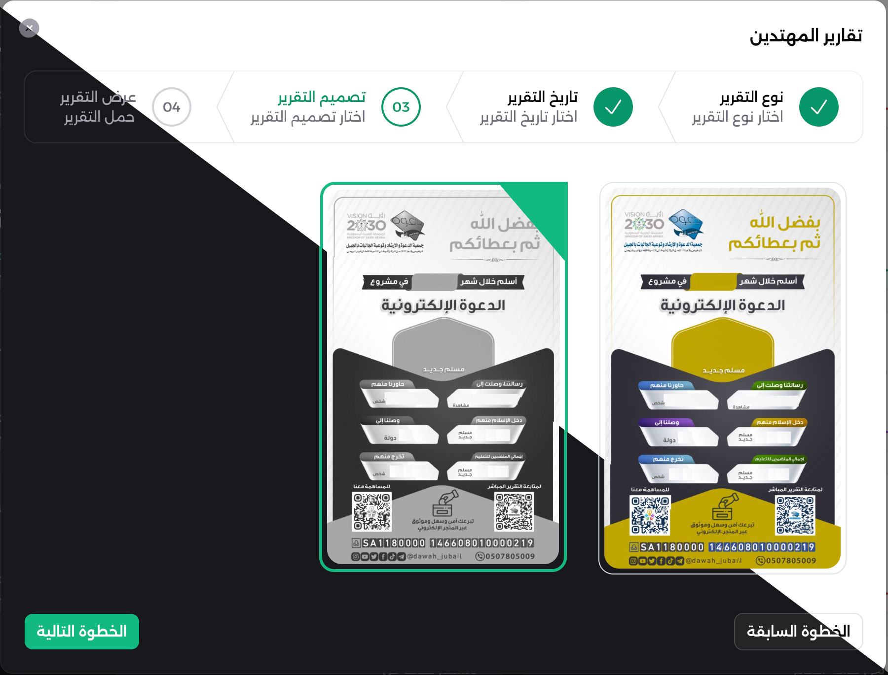

# Botón de Radio con Imagen para Filament

Un componente de formulario para Filament que reemplaza los botones de radio tradicionales con selección de imágenes. Compatible con modo RTL y Modo Oscuro.

[](https://packagist.org/packages/alkoumi/filament-image-radio-button)

[](https://packagist.org/packages/alkoumi/filament-image-radio-button)
[](https://packagist.org/packages/alkoumi/filament-image-radio-button)
[](https://github.com/alkoumi/filament-image-radio-button/actions?query=workflow%3Arun-tests+branch%3Amain)


## Requisitos

| Versión | PHP  | Filament      | Livewire | Laravel          |
|---------|------|---------------|----------|------------------|
| 2.x     | 8.2+ | 3.x, 4.x, 5.x | 3.x, 4.x | 10.x, 11.x, 12.x |
| 1.x     | 8.1+ | 3.x, 4.x      | 3.x      | 10.x, 11.x       |

## Instalación

```bash
composer require alkoumi/filament-image-radio-button
```

### Configuración del tema (Filament 4+)

1. Crea un tema personalizado: [Documentación de Filament](https://filamentphp.com/docs/3.x/panels/themes#creating-a-custom-theme)

2. Agrega las vistas del paquete a tu CSS del tema:

```css
@source '../../../../vendor/alkoumi/filament-image-radio-button/resources/views/**/*.blade.php';
```

3. Registra el tema en tu Panel Provider:

```php
->viteTheme('resources/css/filament/admin/theme.css')
```

4. Compila los activos:

```bash
npm run build
```

## Uso

### Uso básico

```php
use Alkoumi\FilamentImageRadioButton\Forms\Components\ImageRadioGroup;

ImageRadioGroup::make('report_id')
    ->disk('reports')
    ->options(fn () => Report::pluck('file', 'id')->toArray())
```

### API completa

```php
use Alkoumi\FilamentImageRadioButton\Forms\Components\ImageRadioGroup;

ImageRadioGroup::make('report_id')
    ->label(__('Report Design'))
    ->required()
    ->disk('reports')                    // Storage disk name
    ->options(fn () => [...])            // Array of [ id => image_path ]
    ->gridColumns(4)                     // Number of columns (default: 3)
    ->live()                             // Enable live updates
```

### Opciones dinámicas

```php
ImageRadioGroup::make('report_id')
    ->disk('reports')
    ->options(fn (Get $get) => Report::whereType($get('type_id'))->pluck('file', 'id')->toArray())
    ->afterStateUpdated(fn (Get $get, Set $set, ?string $state) =>
        $set('selected_report', Report::find($state))
    )
    ->live()
```

## Configuración

### Configuración del disco de almacenamiento

Define un disco en `config/filesystems.php`:

```php
'reports' => [
    'driver' => 'local',
    'root' => storage_path('app/public/reports'),
    'url' => env('APP_URL') . '/storage/reports',
    'visibility' => 'public',
],
```

### Formato de las opciones

Las opciones deben ser un array donde:

- **Clave**: El valor que se almacenará (por ejemplo, el ID del modelo)
- **Valor**: La ruta de la imagen relativa al disco

```php
// Example: ['1' => 'storage/template1.jpg', '2' => 'storage/template2.png']
Report::pluck('image_path', 'id')->toArray()
```

## Capturas de pantalla



## Registro de cambios

Consulte [CHANGELOG](CHANGELOG.md) para más información sobre los cambios recientes.

## Contribuciones

Consulte [CONTRIBUTING](.github/CONTRIBUTING.md) para más detalles.

## Vulnerabilidades de seguridad

Revise [nuestra política de seguridad](../../security/policy) sobre cómo informar vulnerabilidades de seguridad.

## Créditos

- [Mohamed alkoumi](https://github.com/alkoumi)
- [Todos los colaboradores](../../contributors)

## Licencia

Licencia MIT (MIT). Consulte el [Archivo de licencia](LICENSE.md) para más información.
